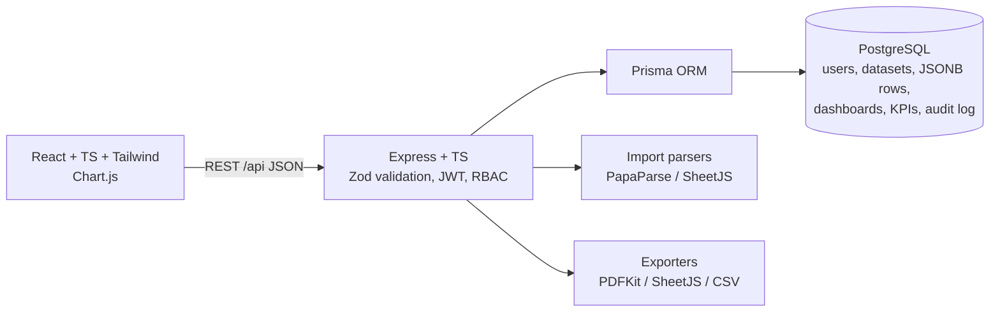

# InsightIQ — Data Analytics & Business Intelligence Dashboard
*Turn business data into better decisions.*

Import CSV / XLSX / JSON data, monitor KPIs against targets, explore data with a safe query builder, build and save custom dashboards, and export real PDF / XLSX / CSV reports.

> **Status:** written and syntax-checked, but **not yet run end-to-end** (see "Verification status"). Run the steps below, then `npm run typecheck` and `npm test`, and fix anything they report.

## Features
- Register / login (JWT), roles **ADMIN / ANALYST / VIEWER**, owner-scoped data enforced on the server
- Import wizard: upload → preview → rename columns / confirm types / map business fields → import → results; import history
- Datasets: search, sort, filter, paginate, preview (sort/search/page), column metadata, rename, delete, "used by dashboards", CSV (streamed) and XLSX export
- Overview: 6 KPI cards with previous-period comparison, date presets, region/category/product/channel/segment filters, 9 charts, click-to-filter drill-down, PDF export
- Analytics Explorer: dimension × measure × SUM/AVG/COUNT/MIN/MAX, filters, chart types, export, save to dashboard
- Dashboards: create, edit, reorder, resize (1–3 columns), change chart type, save, reopen, duplicate, delete (stored in PostgreSQL)
- KPI Center: targets, warning thresholds, achievement %, status, monthly trend
- Reports: PDF / XLSX / CSV of the selected dataset, filters and date range; formula-injection protection
- Activity log, admin user/role management, loading / empty / error states everywhere

## Architecture

```
insightiq/
├── server/  src/{routes,lib,middleware.ts,app.ts}  prisma/{schema.prisma,seed.ts}  tests/
└── client/  src/{pages,ui.tsx,api.ts,auth.tsx}  e2e/
```

## Setup (Windows / macOS / Linux)
1. Install **Node.js 18+**.
2. Create a free PostgreSQL database (easiest: **neon.tech** → new project → copy the connection string, which ends in `?sslmode=require`). Local Postgres also works.
3. In the project folder:
```
npm run setup
copy server\.env.example server\.env        (macOS/Linux: cp server/.env.example server/.env)
```
4. Edit `server/.env`: set `DATABASE_URL`, `AUTH_SECRET` (any 16+ random characters), keep `PORT=4000`, `CLIENT_URL=http://localhost:5173`.
5. Create tables, add demo data, start:
```
npm run db:push
npm run seed
npm run dev
```
6. Open http://localhost:5173. Demo logins (created by the seed): `admin@insightiq.local / Admin@1234`, `analyst@insightiq.local / Analyst@1234`, `viewer@insightiq.local / Viewer@1234`. New users can also register; the very first registered user becomes ADMIN. Or register and click **Load demo data**.

`db:push` applies the Prisma schema directly. To use migration files instead: `cd server && npx prisma migrate dev --name init`.

## Using it
- **Import:** Data Sources → choose a file → preview → map `date` and `revenue` (needed for the Overview), optionally cost/profit/order id/product/category/region/channel/customer/segment → import.
- **Dashboards:** Analytics Explorer → run → "Save to dashboard", or Dashboards → New dashboard → "Add a widget".
- **KPIs:** KPI Center → New KPI (dataset, measure, aggregation, target, warning %, period).
- **Reports:** Reports → choose fields and format → Download.

## Business formulas (`server/src/lib/metrics.ts`)
Revenue Growth % = (Current − Previous) / Previous × 100 · Profit = Revenue − Cost · Margin % = Profit / Revenue × 100 · AOV = Revenue / Orders. Division by zero or a missing previous period returns "—", never a fake number.
Assumptions: orders = distinct values of the mapped Order ID column (or row count if not mapped); profit uses the mapped Profit column, else Revenue − Cost; the previous period is the same number of days immediately before the selected range; **date presets are relative to the latest date in the dataset** (so older uploads still show data); dates like 05/03/2026 are read **day-first**; KPI status: ≥100% Achieved, ≥ warning% On Track, ≥ warning/2 At Risk, else Below Target.

## Data storage strategy
Each imported row is stored as **JSONB** in one `DatasetRow` table (indexed by `datasetId`); column names/types live in `DatasetColumn`. Values are converted to numbers/ISO dates at import. Trade-offs: no per-file schema migrations, no DDL from user input, simple and safe; aggregations cast JSON fields at query time, which is slower than typed columns on millions of rows (add expression indexes or move to per-dataset tables if you outgrow it). Aggregation, filtering, sorting and pagination all run in PostgreSQL; field names are checked against the dataset's column list and sent as bind parameters, never concatenated. The browser never sends SQL.

## Tests
```
npm test                       # server unit tests + client tests
cd server && npm run test:watch
```
- `server/tests/lib.test.ts` — formulas, number/date parsing, type detection, headers, CSV/JSON parsing, formula-injection escaping
- `server/tests/api.test.ts` — API integration (auth, import, KPI maths, filters, date ranges, authorization, dashboards persistence, KPI targets, PDF/XLSX/CSV export). **Skipped unless `TEST_DATABASE_URL` points to a separate, empty database** (it truncates tables).
- `client/src/__tests__/ui.test.tsx` — components, formatting, date presets, protected route
- `client/e2e/smoke.spec.ts` — Playwright (start the app first, `npx playwright install` once, then `npm run test:e2e --prefix client`)

## Production build / deployment
`npm run build`. Backend: any Node host (Render): root `server`, build `npm install && npm run build`, start `npm start`, env vars `DATABASE_URL`, `AUTH_SECRET`, `CLIENT_URL` (your frontend URL). Frontend (Vercel): root `client`, env `VITE_API_URL=https://<api-host>/api` (as a normal, non-secret variable), redeploy after changing it.

## Security
Passwords hashed with bcrypt; JWT auth on every route except register/login/health; Zod validation on all input; owner checks on datasets, dashboards and KPIs (other users' IDs return 404); upload limit 10 MB and type allow-list; row cap 200,000; helmet, CORS allow-list, rate limiting on auth; CSV/XLSX/PDF cells beginning `= + - @` are escaped; secrets only in `.env` (git-ignored).

## Limitations (honest list)
- Not yet executed end-to-end (see below); expect some fixes on first run.
- Sharing between users (`DatasetPermission` / `DashboardPermission`), `Report`, `ImportJob` and `DataSource` tables are **not implemented**: data is owner-only, ADMIN sees everything, VIEWER is read-only on data it can see.
- Dashboard widgets reorder with arrow buttons and resize via a 1–3 column setting (no drag-and-drop). No stacked/scatter charts, no D3 or map visualisation.
- Only CSV/XLSX/JSON connectors work; PostgreSQL / REST / Google Sheets are shown as "Planned".
- PDF reports contain the title, date, dataset, filters and result table (no embedded chart images). XLSX export of raw records is limited to 50,000 rows (CSV is streamed).
- Import runs in the request (no background queue); progress is an activity indicator, not a percentage. Global date range lives on the Overview page, not in the top bar. No notifications/help menu.
